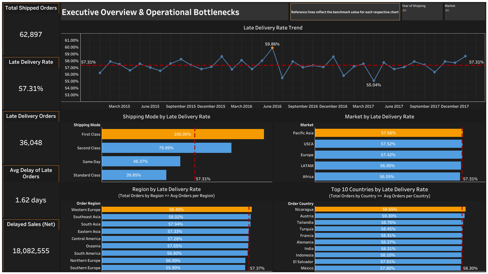

# 🚚 Supply Chain Delivery Delay Analysis & Tableau Dashboard

An end-to-end Business Intelligence project on delivery performance in a distribution company (`62,897` active orders, `57.31%` Late Delivery Rate). The study covers data quality audit, data cleaning and ETL in Python (`pandas`), relational data modeling, KPI definition, and an interactive Tableau Public dashboard built for Root Cause Analysis of late deliveries.

> **Scope note:** this is a descriptive BI project, not a predictive one. No Machine Learning model is built; the goal is to measure the scale of delays, locate bottlenecks, and support logistics decisions.

---

## 📌 Project Overview & Objectives

Customers are dissatisfied and complaints are growing because the **On-Time Delivery** rate has dropped sharply. Management sees that parcels arrive late but does not know where the cause lies: a specific region, overly optimistic shipping estimates, certain shipping methods, or particular product categories.

The goal of this project is to turn raw order data into an analytical tool that helps logistics managers identify bottlenecks and decide where to act first.

**Core Business Questions Addressed:**
1. **Scale of the Problem:** What share of active orders is delivered late, how long are the delays, and how much sales value is exposed?
2. **Time Dimension:** Is the Late Delivery Rate driven by a trend or seasonality?
3. **Operational & Geographic Drivers:** Which Shipping Modes, markets, regions, and countries contribute most to delays?
4. **Product, Customer & Transaction Drivers:** Do departments, categories, customer segments, or payment types explain delays?
5. **Actionable Recommendations:** Where should the company react first, and what should logistics teams audit?

**Dataset:** [DataCo Smart Supply Chain for Big Data Analysis](https://www.kaggle.com/datasets/shashwatwork/dataco-smart-supply-chain-for-big-data-analysis) (Kaggle) — `180,519` order line items, `53` columns, `65,752` unique orders, `20,652` customers, `118` products.

---

## 🛠️ Data Pipeline & Project Workflow

### 1. Data Ingestion & Granularity Check
* **Dataset Loaded:** Imported the raw CSV (`encoding='latin1'`) into Google Colab using `pandas`.
* **Grain Identification:** Each raw row is an **order line item** (`Order Item Id` has `180,519` unique values), which roll up to `65,752` unique orders. Order-level metrics therefore had to be aggregated at the `order_id` level to avoid double-counting multi-item orders.

### 2. Data Quality Audit
* **Duplicates:** `0` duplicated rows, but `7` redundant columns carrying identical values under different names (e.g., `Benefit per order` / `Order Profit Per Order`, `Sales per customer` / `Order Item Total`, `Customer Id` / `Order Customer Id`).
* **Missing Values:** `Product Description` is `100%` empty, `Order Zipcode` is ~`86.2%` empty, while `Customer Lname` (`8` nulls) and `Customer Zipcode` (`3` nulls) are negligible. All of them were excluded from the analytical model.
* **Intra-Order Consistency:** Verified that all items of the same `Order Id` share identical shipping attributes (`0` inconsistent orders out of `65,752`), so every order ships as a single package and can be safely reduced to one row per order.

### 3. Data Cleaning & Preprocessing
* **Feature Selection & Data Minimization:** Dropped `21` columns (duplicate columns, empty columns, and sensitive customer data such as `Customer Email`, `Customer Password`, `Customer Fname`, `Customer Lname`, `Customer Street`), producing `clean_data` with `32` columns.
* **Type Conversion & Standardization:** Converted order and shipping dates to `datetime`, standardized column names to `snake_case`, and stripped whitespace from text columns.

### 4. Delivery Status Logic & Validation
* **Canceled & Fraudulent Orders:** `7,754` line items marked `Shipping canceled` occur exclusively for `CANCELED` (`3,692`) and `SUSPECTED_FRAUD` (`4,062`) orders. The packages were never shipped, so they were excluded from all delivery KPIs.
* **Delay Rule Validation:** Created `shipping_delay_days` (`days_for_shipping_real - days_for_shipment_scheduled`) and confirmed a clean separation: `Advance shipping` = `-2` / `-1` days, `Shipping on time` = `0` days, `Late delivery` = `+1` to `+4` days.
* **`late_delivery_risk` Check:** Cross-tabulation showed a strict one-to-one match with `Late delivery`, so the column is a direct indicator of an actual late delivery, not a forward-looking risk score.
* **Order-Level Result:** After deduplication to orders and excluding `Shipping canceled`, `62,897` active orders remain: `36,048` late (`57.31%`), `15,127` early (`24.05%`), and `11,722` on time (`18.64%`).

### 5. Data Model
The raw table was split into four tables linked by primary and foreign keys for use in Tableau Public, each validated for primary key uniqueness:

| Table | Grain | Rows | Primary Key | Foreign Keys |
| :--- | :--- | ---: | :--- | :--- |
| `order_data` | One row per order | `65,752` | `order_id` | `customer_id` |
| `order_items` | One row per order line item | `180,519` | `order_item_id` | `order_id`, `product_card_id` |
| `product_data` | One row per product | `118` | `product_card_id` | — |
| `customer_data` | One row per customer | `20,652` | `customer_id` | — |

* **Dimensions:** order and shipping attributes (`order_status`, `delivery_status`, `shipping_mode`, `type`), destination geography (`market`, `order_region`, `order_country`), product attributes (`department_name`, `category_name`), and customer attributes (`customer_segment`).
* **Measure Sources:** `order_id` and `order_item_id` (order counts), `days_for_shipping_real`, `days_for_shipment_scheduled`, `shipping_delay_days` (delay metrics), `sales` and `order_item_total` (sales value).

### 6. KPI Definitions & Dashboard (Tableau Public)
KPIs were defined on active orders only (`Shipping canceled` excluded via a context filter):

| KPI | Definition |
| :--- | :--- |
| **Total Orders** | Number of active orders in the analyzed scope |
| **Late Orders** | Number of delayed orders within a dimension or segment |
| **Late Delivery Rate** | `Late Orders / Total Orders` |
| **Average Delay in Days** | Average delay calculated across late orders only |
| **Delayed Sales (Net)** | Net sales value associated with late orders |

The dashboard follows an Overview → Trend → Breakdown structure (global KPIs, monthly trend, Shipping Mode, Market, Region, Country, Department, Category, Customer Segment, and Transaction Type). Country and category rankings apply a volume filter (`Total Orders` ≥ average per country / category) to remove small-sample noise.

---

## 💻 Tech Stack & Tools

* **Environment:** Google Colab, Google Drive
* **Data Preparation & ETL:** `python`, `pandas`
* **Data Visualization & Dashboard:** Tableau Public
* **Data Source:** Kaggle (DataCo Smart Supply Chain)

---

## 📊 Business Key Takeaways & Recommendations

* **Systemic Problem:** `57.31%` of active orders arrive late (`36,048` of `62,897`), with an average delay of `1.62` days among late shipments and `18,082,555` in Delayed Sales (Net). Only `42.69%` of orders are delivered on time or early.
* **Shipping Mode Is the Main Differentiator:**

| Shipping Mode | Total Orders | Late Orders | Late Delivery Rate | Avg Delay (Days) | Delayed Sales (Net) |
| :--- | ---: | ---: | ---: | ---: | ---: |
| First Class | `9,602` | `9,602` | `100.00%` | `1.00` | `4,860,950` |
| Second Class | `12,256` | `9,803` | `79.99%` | `2.50` | `4,918,063` |
| Same Day | `3,407` | `1,648` | `48.37%` | `1.00` | `787,237` |
| Standard Class | `37,632` | `14,995` | `39.85%` | `1.50` | `7,516,306` |

* **No Seasonality, No Geographic Hotspot:** The monthly Late Delivery Rate fluctuates in a narrow band around the global benchmark (peak `59.86%` in June 2016, trough `55.04%` in April 2017). Rates are also nearly identical across markets (`56.55%`–`57.68%`) and regions (average delay `1.59`–`1.64` days), so delays are not explained by calendar timing or location.
* **Small-Sample Caution:** The highest percentage rates in smaller segments, such as `Pet Shop` (`61.44%`, `472` orders) or `Accessories` (`59.82%`, `1,670` orders), sit on small order bases. Business impact is concentrated in high-volume areas such as `Fan Shop` (`8,426,022` Delayed Sales), `Apparel`, `Fishing`, and `Cleats`.
* **Customer & Payment Segments:** Late Delivery Rate is flat across segments (`Consumer` `57.25%`, `Corporate` `57.16%`, `Home Office` `57.74%`) and payment types, with `Consumer` and `DEBIT` carrying the largest volumes.

**Recommended Actions:**
1. **Audit `First Class` and `Second Class` parameters:** review promised transit lead times, carrier SLAs, and dispatch schedules, since `First Class` is late in `100%` of orders and `Second Class` has the longest average delay (`2.50` days).
2. **Prioritize by volume and Delayed Sales, not by `%` on small samples:** focus quality checks, inventory readiness, and carrier management on `Standard Class`, `Europe` / `Western Europe` / `Central America`, `Fan Shop` and `Apparel`, and categories such as `Fishing` and `Cleats`.
3. **Standardize year-round execution:** because the rate stays near `57.31%` without seasonal spikes, fix recurring fulfillment and handoff bottlenecks and track `Late Delivery Rate`, `Delayed Sales (Net)`, and `Average Delay in Days` in regular logistics reviews.

**Limitations:** the analysis is descriptive and shows associations, not proven causes. Delays are defined as actual vs. scheduled shipping days from the source data, and country names are kept as they appear in the source dataset (e.g., `Francia`, `México`, `Alemania`).

---

## 🔗 Project Links

* 👉 [Open Google Colab Notebook](https://colab.research.google.com/drive/1o-iUOZBImRubvlK5Snpx4gBi3dHL4_gS?usp=sharing)
* 👉 [Open Interactive Tableau Public Dashboard](https://public.tableau.com/views/SupplyChainDelayRootCauseAnalysis_17950911518140/ExecutiveOverviewOperationalBottlenecks)
* 👉 [Dataset on Kaggle](https://www.kaggle.com/datasets/shashwatwork/dataco-smart-supply-chain-for-big-data-analysis)
